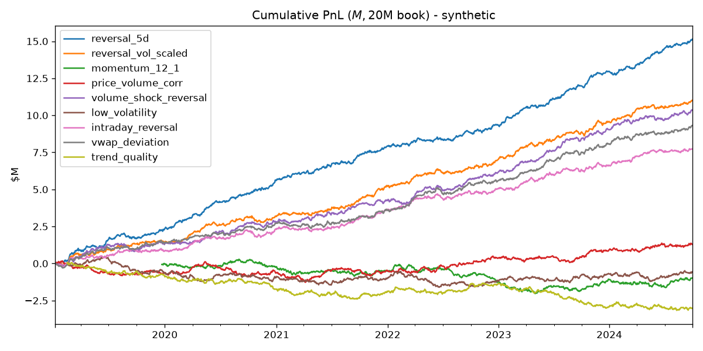

# quant-alpha

**A local research lab for WorldQuant BRAIN-style equity alphas.**
Write an alpha as a BRAIN *Fast Expression*, backtest it on daily stock data,
and get the same numbers BRAIN reports: Sharpe, Fitness, Turnover, Returns,
Drawdown and Margin, plus BRAIN's submission checks and PnL self-correlation.

Built by Karan ([@udaipurkagamer](https://github.com/udaipurkagamer)) to iterate on alpha ideas offline before
spending simulations on [WorldQuant BRAIN](https://platform.worldquantbrain.com).


```python
from alpha import evaluate, simulate, Settings
from alpha.data import load

data = load("yfinance")                                   # ~110 US large caps
alpha = evaluate("rank(-ts_delta(close, 5))", data)       # same syntax as BRAIN
res = simulate(alpha, data, Settings(decay=4, neutralization="sector"))
print(res.summary())   # Sharpe | Fitness | Returns | Turnover | Drawdown | Margin
```

## Why this exists

BRAIN simulations are slow and limited, and you can't see inside them. This
repo reimplements the core of the BRAIN simulator so that:

- ideas can be screened in seconds, across many settings at once (`sweep.py`);
- every step (decay, neutralization, truncation, delay) is visible and testable;
- the same expression string can be pasted straight into BRAIN once it looks good.

## Features

| | |
|---|---|
| **30+ BRAIN operators** | `rank`, `zscore`, `ts_delta`, `ts_corr`, `ts_rank`, `ts_decay_linear`, `ts_regression`, `group_neutralize`, `group_rank`, `hump`, `winsorize`, ... ([alpha/operators.py](alpha/operators.py)) |
| **Fast Expression parser** | Runs BRAIN strings directly, including `cond ? a : b`, `&&`/`\|\|`, and multi-line `x = ...; ...` ([alpha/expression.py](alpha/expression.py)) |
| **BRAIN-style simulator** | pasteurize → decay → neutralize (market/sector/industry) → scale → truncate → delay → PnL ([alpha/backtest.py](alpha/backtest.py)) |
| **BRAIN metrics & checks** | Sharpe, Fitness, Turnover, Returns, Drawdown, Margin, yearly breakdown, rank IC, submission tests, PnL self-correlation |
| **Settings sweep** | Grid over decay / neutralization / truncation for one alpha ([sweep.py](sweep.py)) |
| **Data** | `yfinance` (US large caps by sector), your own CSV, or a synthetic market for bias testing ([alpha/data.py](alpha/data.py)) |
| **Look-ahead tests** | pytest suite proves the simulator can't peek at future data ([tests/](tests/test_sanity.py)) |

## Quick start

**Easiest (no commands):** download/clone the repo, then
- **Windows:** double-click `setup.bat` once, then `run.bat` any time.
- **Mac/Linux:** `./setup.sh` once, then `./run.sh` (extra args pass through, e.g. `./run.sh --data yfinance`).

These create a local `venv/` and install everything for you. Manual route:

```bash
pip install -r requirements.txt
python run.py                                      # full alpha library, offline synthetic data
python run.py --data yfinance                      # real US large caps (needs internet)
python run.py --expr "rank(-ts_delta(close, 5))" --decay 4 --neutralization sector
python sweep.py "rank(-returns)" --decays 0 4 8    # try a grid of BRAIN settings
pytest -q
```

Each run writes `reports/summary.csv` and a cumulative PnL chart `reports/pnl.png`.

## Metric definitions (same as BRAIN)

| Metric | Formula |
|---|---|
| Sharpe | mean(daily PnL) / std(daily PnL) × √252 |
| Returns | annual PnL / (book / 2) |
| Turnover | daily $ traded / book |
| Fitness | Sharpe × √(\|Returns\| / max(Turnover, 0.125)) |
| Drawdown | max peak-to-trough of cumulative PnL / (book / 2) |
| Margin | total PnL / total $ traded (bps) |

**Delay 1** (BRAIN default): the book traded at today's close only uses data
up to yesterday's close. `test_future_data_is_not_used_with_delay1` checks this.

## Starter alpha library

Nine price/volume alphas in [alpha/library.py](alpha/library.py), each with the idea behind it:
short-term reversal, volatility-scaled reversal, 12-1 momentum, price-volume
correlation, volume-shock reversal, low volatility, intraday reversal, VWAP
deviation and trend quality.

## Validating the simulator

A backtester is only useful if it finds real effects and ignores fake ones.
The synthetic market (`--data synthetic`) contains exactly **one** planted
anomaly, a 5-day reversal. A correct pipeline should find that and score
everything unrelated near zero:

| alpha | Sharpe | Fitness | Turnover | BRAIN checks |
|---|---:|---:|---:|---:|
| reversal_5d | **3.89** | **3.13** | 39% | 5/5 |
| reversal_vol_scaled | 2.90 | 1.29 | 94% | 4/5 |
| volume_shock_reversal | 2.74 | 1.28 | 80% | 4/5 |
| momentum_12_1 | -0.32 | -0.13 | 3% | 2/5 |
| low_volatility | -0.16 | -0.05 | 3% | 2/5 |

Reversal-family alphas light up; momentum and low-vol (not planted) stay at ~0.
The high-turnover variants fail BRAIN's 70% turnover cap, which is what `sweep.py`'s higher decay values are for.



## Limitations

- Free Yahoo data only covers today's large caps, so it has survivorship bias
  and results will look better than on BRAIN's TOP3000.
- `vwap` is approximated by the typical price (H+L+C)/3; `cap` is a rough proxy.
- No transaction costs beyond what Margin tells you (BRAIN also ignores them in Sharpe).

## Roadmap

- [ ] Fundamental and analyst datasets (BRAIN `fundamental6`, `analyst4` style)
- [ ] Out-of-sample split and a simple overfitting score
- [ ] Combine alphas into a portfolio (equal-weight, then ML) with a correlation budget

## License

MIT
